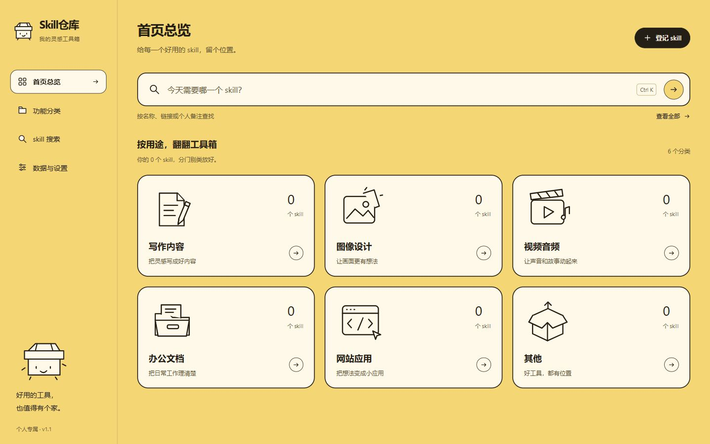

#技能仓库

为每一个好用的技能，留个位置。

一个离线使用的个人 skill 链接工具箱。记下名称、链接和自己的使用心得，按用途快速找到下一次工作要用的工具。




## 直接使用

Windows 10/11 的 64 位电脑，下载发布页中的任意一种：

**[打开最新版本下载页](https://github.com/niuwa77/skill-repository/releases/latest)** · [下载便携版 EXE](https://github.com/niuwa77/skill-repository/releases/latest/download/SkillVault-1.2.0-Windows-x64-Portable.exe) · [下载安装版 EXE](https://github.com/niuwa77/skill-repository/releases/latest/download/SkillVault-1.2.0-Windows-x64-Setup.exe)

在发布页展开 **Assets** 下载以 `.exe` 结尾的文件。`Source code (zip)` 和 `Source code (tar.gz)` 是开发源码，普通使用者请选择下面的安装版或便携版。

| 文件 | 用法 |
| --- | --- |
| `SkillVault-版本-Windows-x64-Portable.exe` | 便携版，双击直接打开，无需安装。 |
| `SkillVault-版本-Windows-x64-Setup.exe` | 安装版，可选择安装位置，并创建桌面及开始菜单快捷方式。 |

普通使用者无需安装 Node.js、浏览器扩展或数据库，也不需要启动服务。直接把便携版 EXE 分享给别人即可，对方会获得一个空的工具箱。

本项目的公开构建暂未配置代码签名，Windows 可能显示“未知发布者”或信誉提示；维护者可为后续正式发行增加自己的签名证书。下载时可用同一发布页的 `SHA256SUMS.txt` 校验文件。

## 功能

- 首页：搜索与六个分类入口。
- 登记：**skill 名称、skill 链接、个人备注、分类**，只有名称必填。
- 分类：**写作内容、图像设计、视频音频、办公文档、网站应用、其他**。支持多选和批量归类；没选分类时放入其他。
- 搜索：按名称、链接和个人备注查找，按分类筛选、按名称或修改时间排序。
- 详情：查看、编辑登记、复制或打开链接。
- 数据：导出 JSON 备份、从备份恢复、输入确认文字后清空登记。

应用本身不需要联网。只有主动打开某条 skill 的网页链接时，才由系统浏览器访问相应网站。应用管理的是登记信息，不执行 skill，也不安装或删除原始插件。

## 数据保存在谁的电脑

桌面版保存到当前 Windows 用户的 `%APPDATA%/SkillVault/`。使用相同 Windows 账户时，移动 EXE、重新下载便携版或更新安装版仍使用同一份数据。两种桌面版也共用这一目录。

程序文件、源码和分享包不包含作者的个人登记。每个人的数据都保存在自己的电脑上，不会上传 GitHub，没有登录、云数据库、账号同步或统计上报。

请定期通过「数据与设置」导出备份。备份包含登记链接和备注，请自行保管。卸载应用默认保留数据；手动清除数据目录或清空登记仍会移除内容。

### 从浏览器版迁移

旧的浏览器版与桌面版使用独立存储。请先在原浏览器版导出备份，再在桌面版选择「恢复备份」。旧版备份中的名称和个人备注保留；无法对应现有分类的登记归入其他。

## 本地开发

Node.js 24 LTS、pnpm 11.25.0。开发者可运行：

```powershell
pnpm install --frozen-lockfile
pnpm exec install-electron
pnpm test
pnpm check
pnpm start
```

如果只想使用浏览器版，可运行 `pnpm start:web` 或 `node server.mjs`，再打开固定地址 `http://127.0.0.1:4317/`。原有 CMD 启动脚本继续支持浏览器版。

## 构建与分享

在 Windows x64 中：

```powershell
pnpm build:win --config.electronDist=node_modules/electron/dist
node scripts/smoke-runner.mjs release/win-unpacked/SkillVault.exe
pnpm package:source
pnpm checksum
```

`release/` 中会生成两种 EXE、源码 ZIP 和 SHA256 校验和。程序自带运行时，体积会比网页源码大。

源码 ZIP 使用明确的文件允许列表，排除测试记录、缓存、个人数据和证书。解压 `*-source.zip` 得到的目录就是可上传 GitHub 的项目根目录；不要上传 `node_modules` 或本机用户数据。

## GitHub 自动发布

源码包含两个 GitHub Actions 工作流：

- 推送 main 或提交 Pull Request：运行单元测试与源码检查。
- 推送 `v*` 标签：构建 Windows 两种 EXE，验证已打包应用的保存及备份能力，生成源码包与校验和，并附加到 GitHub Release。

发布前会分别运行未封装目录、最终便携 EXE、实际执行安装程序后得到的 EXE，检查登记保存、退出重开及 JSON 备份。测试数据使用独立目录；只有这些检查全部通过，才会上传发行文件。

也可以在 Actions 页面手动运行 Windows release 工作流，先下载构建 artifact。手动构建不带版本标签时不会创建 Release。

没有配置自动更新服务；新版本可重新下载并继续使用本机已有数据。

## 项目结构

```text
dist/               界面与浏览器本地数据逻辑
desktop/            Electron 主进程、本地资源和链接策略
assets/             自有图标及源 SVG
tests/              数据迁移、备份、链接与桌面策略测试
scripts/            检查、桌面验证、源码打包与校验和
.github/workflows/  自动检查及 Windows 发布流程
```

界面完全使用原生 HTML、CSS、JavaScript 和 SVG，不依赖外部字体或网络图片。更多开发说明见 [CONTRIBUTING.md](CONTRIBUTING.md)，数据说明见 [SECURITY.md](SECURITY.md)。

## 开源许可

自有代码及图标使用 [MIT License](LICENSE)。桌面发行包包含的 Electron、Chromium 等第三方组件遵循各自许可，见 [THIRD_PARTY_NOTICES.md](THIRD_PARTY_NOTICES.md)。
